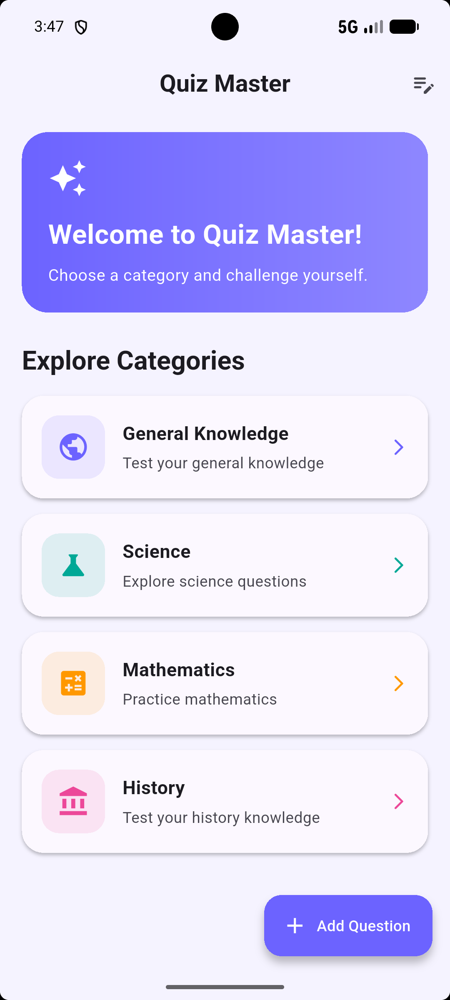
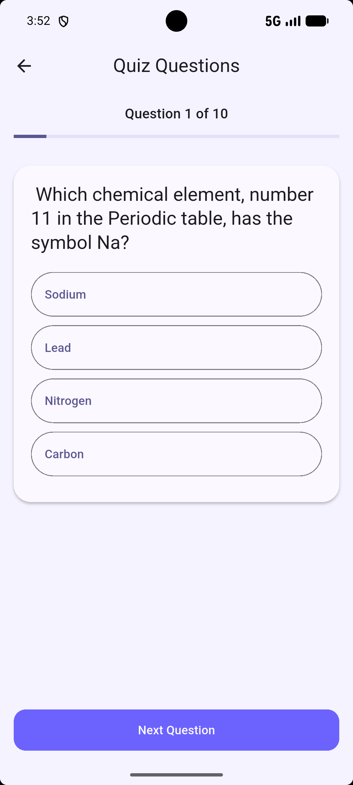
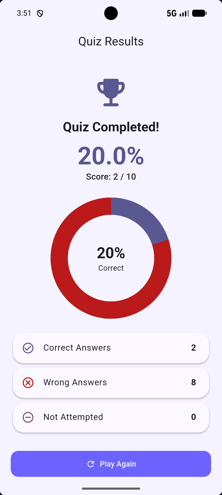
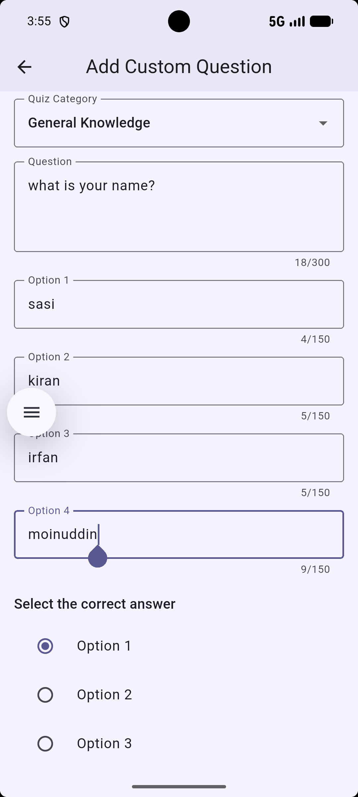
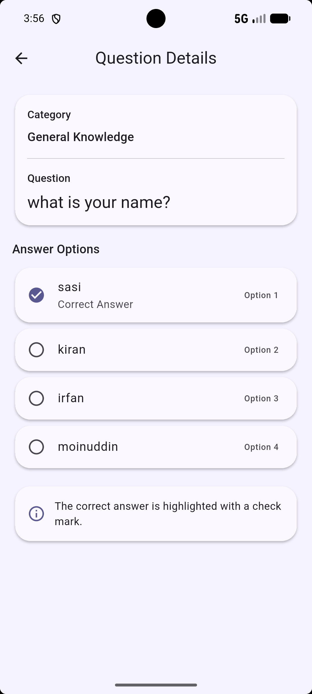

# Quiz Master: Flutter Quiz Application

## Project Overview

**Quiz Master** is a Flutter-based Android quiz application developed as a college group project by a team of three students.

The application allows users to attempt quizzes across different subjects, create and manage their own questions, view quiz results, and track their best scores.

The project demonstrates Flutter UI development, Provider state management, public API integration, local data storage, form validation, and GitHub team collaboration.

## Features

- **Four Quiz Categories:** General Knowledge, Science, Mathematics, and History.
- **Online Quiz Questions:** Questions are retrieved from the Open Trivia Database API.
- **Randomized Questions:** Question order is shuffled for quiz attempts.
- **Custom Questions:** Users can create and save their own multiple-choice questions.
- **Form Validation:** Required fields and correct-answer selection are validated before saving.
- **Manage Questions:** Users can view and delete saved custom questions.
- **Question Detail View:** Tapping a saved question displays its full details and correct answer.
- **Quiz Results:** Results include a donut chart showing correct, wrong, and unanswered questions.
- **Score Calculation:** Displays quiz performance as a percentage.
- **Best Score Storage:** Best scores are saved locally.
- **Offline Error Handling:** Displays an error message and Retry button when online questions cannot be loaded.
- **Responsive UI:** Supports portrait and landscape orientations.
- **Custom Theme:** Uses Material 3 with a consistent purple theme and custom launcher icon.

## Technology Stack

| Technology | Purpose |
|---|---|
| Flutter | Mobile application development |
| Dart | Programming language |
| Provider | State management using ChangeNotifier |
| Open Trivia Database | Online quiz questions |
| SharedPreferences | Local storage |
| Android Studio | Development and testing |
| Git and GitHub | Version control and collaboration |

## Application Screens

The application includes the following functional screens:

1. **Category Screen:** Displays quiz categories and navigation options.
2. **Quiz Questions Screen:** Displays questions, answer options, and quiz progress.
3. **Quiz Results Screen:** Displays the final score and result chart.
4. **Add Question Screen:** Allows users to create questions with input validation.
5. **Manage Questions Screen:** Lists saved custom questions with a delete option.
6. **Question Details Screen:** Displays complete information about a selected custom question.

## Project Structure

```text
lib/
├── main.dart
├── models/
│   ├── question.dart
│   └── quiz_category.dart
├── providers/
│   └── quiz_provider.dart
├── screens/
│   ├── category_screen.dart
│   ├── question_screen.dart
│   ├── result_screen.dart
│   ├── add_question_screen.dart
│   ├── manage_questions_screen.dart
│   └── question_detail_screen.dart
├── services/
│   ├── quiz_api_service.dart
│   └── quiz_service.dart
├── theme/
│   └── app_theme.dart
└── widgets/
```

## Data Source and Storage

Quiz Master uses the **Open Trivia Database API** to retrieve multiple-choice questions.

API website: https://opentdb.com/

Online questions require an Internet connection. If an API request fails, the application can use locally saved custom questions for the selected category. If no questions are available, it displays an error message with a Retry option.

Custom questions and best scores are stored locally using SharedPreferences, allowing them to persist across application restarts.

## Installation and Setup

### Prerequisites

- Flutter SDK 3.35 or later
- Dart SDK included with Flutter
- Android Studio or VS Code
- Android SDK
- Android emulator or physical Android device
- Internet connection for online quizzes

### Clone the Repository

```bash
git clone https://github.com/248x1a42d6/flutter-quiz-app.git
cd flutter-quiz-app
```

### Install Dependencies

```bash
flutter pub get
```

### Run the Application

```bash
flutter run
```

### Run Code Analysis

```bash
flutter analyze
```

### Run Automated Tests

```bash
flutter test
```

### Build Release APK

```bash
flutter build apk --release
```

The generated APK will be located at:

```text
build/app/outputs/flutter-apk/app-release.apk
```

## Team Members and Contributions

| Team Member | College ID | Contributions |
|---|---|---|
| Team Leader | 248x1a42d6 | Project setup, GitHub repository management, quiz functionality, API integration, Provider implementation, testing, and Pull Request reviews |
| Member 2 | 248x1a42e2 | UI improvements, app theme and branding, Manage Questions functionality, and GP4 form validation |
| Member 3 | 248x1a42e4 | Quiz Results improvements, score visualization, and GP5 Question Detail View |

### GitHub Contributor Clarification

**Note:** This project was developed by three team members. The team leader used two different Git commit author identities (`sasikiransankaramanchi-debug` and `248x1a42d6`) while working on the project. As a result, GitHub displays four contributors, although the project has only three team members.

## GitHub Collaboration Workflow

The team followed a branch-based development process:

1. Each feature was developed on a separate branch.
2. Changes were committed and pushed to GitHub.
3. Team members created Pull Requests.
4. The team leader reviewed and merged the changes into the `main` branch.
5. The application was tested after integrating features.

Major feature branches included:

- `feature/quiz-improvements`
- `feature/member2-ui-improvements`
- `feature/member3-results-improvements`
- `feature/member2-manage-questions`
- `feature/gp3-screen-states`
- `feature/gp4-form-validation`
- `feature/gp5-question-details`

## Testing and Validation

The application has been tested on a Pixel Android emulator.

| Test Case | Result |
|---|---|
| Form validation for empty fields | Passed |
| Custom question creation | Passed |
| Custom question deletion | Passed |
| Question Detail View | Passed |
| Offline error handling | Passed |
| Internet recovery using Retry | Passed |
| Rapid Next Question tapping | Passed |
| Unanswered question score calculation | Passed |
| Long question and option text | Passed |
| Portrait and landscape rotation | Passed |
| Flutter analysis and automated tests | Passed |

## Error Handling

The application includes handling for:

- Missing Internet connectivity
- Failed online question requests
- Empty question lists
- Missing required form inputs
- Invalid category selection
- Missing correct-answer selection
- Question saving and deletion failures

Users receive clear messages when an operation cannot be completed.

## Known Limitations

- Online questions require Internet connectivity.
- Offline quizzes depend on locally saved custom questions.
- The app's Home Screen uses four predefined categories; its empty state is verified through widget testing.
- Question shuffling is implemented, but preventing repeats across every future app session is not guaranteed.
- The Android launcher label currently displays `quiz_app`.


## Application Screenshots

### 1. Category Screen


### 2. Quiz Questions Screen


### 3. Quiz Results Screen


### 4. Add Question Screen


### 5. Question Details Screen



## Release APK

The Android release APK will be added after the final release build and physical-device verification.

## Defect Log

| Issue | Resolution | Status |
|---|---|---|
| Quiz questions unavailable without Internet | Added error message and Retry button | Fixed |
| Correct answer automatically selected in custom question form | Added mandatory correct-answer selection | Fixed |
| Long text and landscape layout needed verification | Tested scrolling and screen rotation | Verified |
| Home Screen empty categories state is not naturally reachable | Added simulated empty-state widget test | Test coverage added |

## Future Enhancements

- Additional quiz categories
- Quiz difficulty selection
- Offline question packs
- Improved cross-session question repetition prevention
- More detailed quiz history
- Further accessibility and UI improvements

## Conclusion

Quiz Master demonstrates the development of a functional Flutter quiz application using Provider, API integration, persistent local storage, validated forms, and responsive interfaces.

The application was developed collaboratively by three team members using GitHub branches, commits, and Pull Requests.
